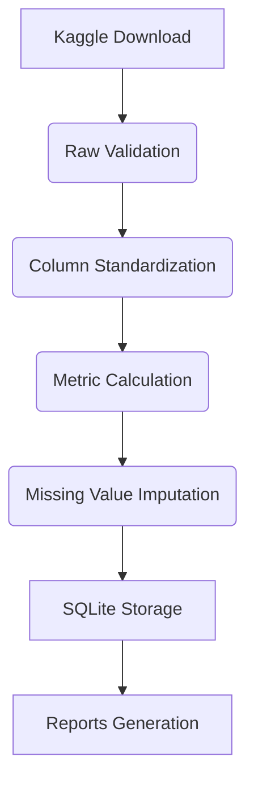

# Volve Production Data Analysis Pipeline



## Overview
This project provides an end-to-end pipeline for processing Volve oil field production data. It transforms raw Excel production reports into a standardized SQLite database with automated data quality validation and visualization-ready formats. Key features include:

- Automated Kaggle API data acquisition
- Production metric calculation (Water Cut, Gas-Oil Ratio)
- Well-specific missing value imputation
- Multi-format output (SQLite, CSV, Parquet)
- Data quality reporting with key statistics

## Target Audience
- Petroleum engineers analyzing production trends
- Reservoir engineers evaluating well performance
- Data scientists in energy sector
- Academic researchers in petroleum engineering
- Energy investment analysts

## Prerequisites
**Knowledge:**
- Basic Python (Pandas, SQLAlchemy)
- Petroleum engineering fundamentals
- SQL query basics

**Hardware:**
- 4GB RAM minimum
- 500MB storage

**Software:**
- Python 3.8+
- SQLite 3.0+

## Installation
```bash
git clone https://github.com/your-username/petroleum-data-ai.git
cd petroleum-data-ai

# Create virtual environment
python -m venv venv

# Activate environment
venv\Scripts\activate            # Windows
source venv/bin/activate           # Linux/macOS

# Install dependencies
pip install -r requirements.txt
```

## Environment Setup
1. Register at [Kaggle.com](https://www.kaggle.com)
2. Create API token (kaggle.json)
3. Place token in project root:
```bash
mv ~/Downloads/kaggle.json .
```
4. Download dataset:
```bash
python src/pipeline/download_kaggle_data.py
```

Verify file exists at `data/raw/Volve production data.xlsx`

## Usage
### Full Pipeline Execution
```bash
python src/pipeline/clean_data.py
```

### Output Validation
```bash
python verify_data.py
```

### Sample Database Query
```python
import pandas as pd
from sqlalchemy import create_engine

engine = create_engine("sqlite:///data/db/volve_production.db")
prod_data = pd.read_sql("""
    SELECT well_bore_code, AVG(water_cut) AS avg_water_cut
    FROM daily_production
    WHERE well_type = 'PRODUCER'
    GROUP BY well_bore_code
""", engine)
print(prod_data.head())
```

## Data Requirements
- **Source**: [Volve Production Data](https://www.kaggle.com/datasets/lamyalbert/volve-production-data)
- **Format**: Microsoft Excel (.xlsx)
- **Sheets**: "Daily Production Data", "Monthly Production Data"
- **Location**: `data/raw/Volve production data.xlsx`

## Testing
### Pipeline Validation
```bash
python verify_data.py

# Expected output:
[OK] Raw dataset located: data/raw/Volve production data.xlsx
[OK] Production records: 23,367
[OK] Database integrity verified
```

### Unit Tests (Development)
```bash
pytest tests/
```

## Methodology
### Data Processing Workflow
1. **Column Standardization**:
   - Snake_case conversion
   - Special character removal
```python
.columns.str.lower().str.replace(r'[^a-z0-9_]', '', regex=True)
```

2. **Derived Metrics**:
   - Water Cut = Water Volume / (Oil + Water)
   - GOR = Gas Volume / Oil Volume

3. **Missing Value Treatment**:
   - Per-well forward filling
   - Rolling average smoothing
   - Zero substitution for production metrics

## Performance
| Operation | Records | Duration | Hardware |
|-----------|---------|----------|----------|
| Full ETL | 23,367 | 8.3s | i5-1135G7, 16GB RAM |
| SQLite Export | 23,367 | 1.2s | NVMe SSD |
| Water Cut Calculation | 23,367 | 0.4s | Pandas Vectorized |

## License
MIT License - see [LICENSE](https://github.com/your-username/petroleum-data-ai/blob/main/LICENSE)

## Contributing
1. Fork repository
2. Create feature branch (`git checkout -b feature/water-cut-analysis`)
3. Commit changes (`git commit -am 'Add water cut visualization'`)
4. Push to branch (`git push origin feature/water-cut-analysis`)
5. Open pull request

See [CONTRIBUTING.md](CONTRIBUTING.md) for coding standards.

## Changelog
### v1.0.0 (Current)
- Initial pipeline implementation
- SQLite database integration
- Data quality reporting
- Kaggle API integration

## Citation
```bibtex
@software{Anthony_Petroleum_Data_AI_2026,
  author = {Anthony, Emmanuel},
  title = {{Petroleum Data AI Toolkit}},
  url = {https://github.com/your-username/petroleum-data-ai},
  version = {1.0.0},
  year = {2026}
}
```

## Contact
[Email Support](mailto:petroleum-data-support@example.com) | 
[Issue Tracker](https://github.com/your-username/petroleum-data-ai/issues)

**Project Maintainer:** Emmanuel Anthony