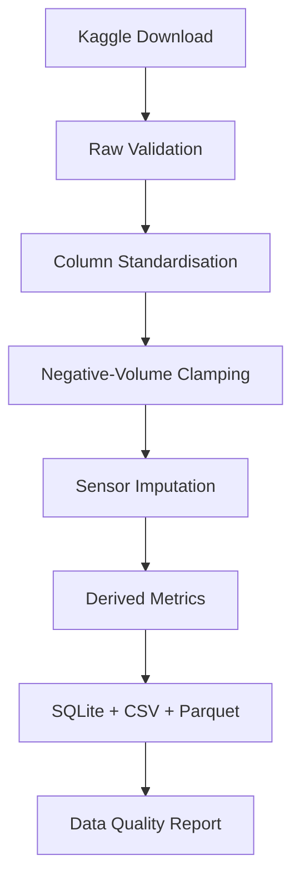

# Petroleum Data AI – Volve Production Pipeline

> **Project 1 & 2 · Data Acquisition, Quality Foundation & Interactive Production Dashboard**



## Overview

An end-to-end ETL pipeline for the **Volve oil field** production dataset.
Raw Excel production reports are transformed into a clean, query-ready SQLite
database with automated data quality reporting.

**Key features:**

| Feature | Detail |
|---|---|
| Data source | Kaggle · `lamyalbert/volve-production-data` |
| Granularity | Daily + Monthly production per well bore |
| Outputs | SQLite, CSV, Parquet |
| Derived metrics | Water cut, GOR, on-stream efficiency |
| Well typing | Time-aware per-row PRODUCER / INJECTOR label |
| QC report | Missing % by well, completeness timeline, outlier stats |

---

## Quick Start

### 1 · Clone & install

```bash
git clone https://github.com/Numba1ne/petroleum-data-ai.git
cd petroleum-data-ai

python -m venv .venv
# Windows
.venv\Scripts\activate
# Linux / macOS
source .venv/bin/activate

pip install -r requirements.txt
```

### 2 · Configure Kaggle credentials

> ⚠️ **Never put your API key in source code or commit it to git.**

**Recommended – kaggle.json:**

1. Go to [kaggle.com/settings](https://www.kaggle.com/settings) → *Create New Token*.
2. Save the downloaded `kaggle.json` to `~/.kaggle/kaggle.json`.
3. On Linux/macOS: `chmod 600 ~/.kaggle/kaggle.json`

*Alternatively*, use a `.env` file:

```bash
cp .env.example .env
# Edit .env and fill in KAGGLE_USERNAME and KAGGLE_KEY
```

**One-time helper script** (writes `~/.kaggle/kaggle.json` for you):

```bash
python setup_kaggle.py --username <your_username> --key <your_api_key>
```

### 3 · Download the dataset

```bash
python src/pipeline/download_kaggle_data.py
# Optional: override destination
python src/pipeline/download_kaggle_data.py --dest data/raw
```

Verify the file landed at `data/raw/Volve production data.xlsx`.

### 4 · Run the pipeline

```bash
python src/pipeline/clean_data.py
# Optional: use a custom Excel path
python src/pipeline/clean_data.py --input path/to/custom.xlsx
```

### 5 · Verify outputs

```bash
python verify_data.py
```

Expected output:

```
── Volve Pipeline Verification ─────────────────────────────────────
  [OK]  Raw Excel                   Volve production data.xlsx  (...)
  [OK]  Daily CSV                   daily_production_clean.csv  (...)
  [OK]  Daily Parquet               daily_production_clean.parquet  (...)
  [OK]  Monthly CSV                 monthly_production_clean.csv  (...)
  [OK]  Monthly Parquet             monthly_production_clean.parquet  (...)
  [OK]  SQLite database             volve_production.db  (...)
  [OK]  Data quality report         data_quality_report.md  (...)

  Daily production rows:   23,367
  Monthly production rows: ...

  Result: 7 passed, 0 failed
────────────────────────────────────────────────────────────────────
```

### 6 · Launch the Interactive Dashboard

```bash
streamlit run dashboard/app.py
```

Navigate to [http://localhost:8501](http://localhost:8501) in your browser:
- **Field Overview KPIs**: Cumulative Oil, Gas, Water, and Water Injected, plus field Water Cut and average GOR.
- **Role & Well Filtering**: Toggle between All Wells, Producers Only, or Injectors Only with dynamic well selection.
- **Fluid Rate Visualisations**: Interactive Plotly time-series for oil, gas, water, and water injection rates.
- **Reservoir Diagnostics**: Water cut evolution (%) with 50% and 80% breakthrough thresholds, and GOR history.
- **Well Rankings**: Grouped bar charts, interactive leaderboard with formatted metrics, and CSV export.

---

## Project Structure

```
petroleum-data-ai/
├── src/
│   ├── config.py                    # Central paths & constants
│   └── pipeline/
│       ├── download_kaggle_data.py  # Kaggle API download
│       └── clean_data.py            # ETL + QC report
├── data/
│   ├── raw/                         # Raw Excel (gitignored)
│   ├── processed/                   # Cleaned CSV + Parquet (gitignored)
│   └── db/                          # SQLite database (gitignored)
├── reports/                         # Auto-generated QC report (gitignored)
├── notebooks/                       # Exploratory analysis
├── tests/                           # Unit tests
├── dashboard/
│   ├── app.py                       # Streamlit interactive dashboard
│   └── utils.py                     # Cached data loader & ranking analytics
├── setup_kaggle.py                  # One-time credential helper
├── verify_data.py                   # Pipeline output check
├── requirements.txt
├── .env.example                     # Credential template (safe to commit)
└── .gitignore
```

---

## Querying the Database

```python
import pandas as pd
from sqlalchemy import create_engine

engine = create_engine("sqlite:///data/db/volve_production.db")

# Average water cut per producer well
df = pd.read_sql("""
    SELECT well_bore_code,
           ROUND(AVG(water_cut), 3)   AS avg_water_cut,
           ROUND(AVG(gor), 1)         AS avg_gor,
           COUNT(*)                   AS days
    FROM daily_production
    WHERE well_type = 'PRODUCER'
      AND bore_oil_vol > 0
    GROUP BY well_bore_code
    ORDER BY avg_water_cut DESC
""", engine)
print(df)
```

---

## Cleaning Logic

| Step | Daily | Monthly |
|---|---|---|
| Column normalisation | ✓ snake_case | ✓ snake_case |
| Date parsing | ✓ | ✓ |
| Negative volumes → NaN | ✓ reported in QC | ✓ |
| Sensor imputation | rolling(7) → ffill → bfill per well | – |
| Well type labelling | per-row time-aware | – |
| Water cut / GOR | safe division (NaN on zero denom) | – |
| On-stream efficiency | clipped to [0, 1] | – |

---

## Data License

The Volve dataset is published by **Equinor** under the
[Equinor Open Data License](https://www.equinor.com/en/how-and-why/digitalisation-in-our-dna/volve-field-data-village-download.html).
Please review the license terms before using this data in commercial projects.

The Kaggle mirror used here: <https://www.kaggle.com/datasets/lamyalbert/volve-production-data>

---

## Prerequisites

| Requirement | Version |
|---|---|
| Python | 3.10+ |
| RAM | ≥ 4 GB |
| Disk | ≥ 500 MB (raw Excel is ~40 MB) |

---

## Running Tests

```bash
pytest tests/
```

---

## Contributing

1. Fork the repository.
2. Create a feature branch: `git checkout -b feature/your-feature`.
3. Commit your changes: `git commit -am 'Add your feature'`.
4. Push: `git push origin feature/your-feature`.
5. Open a pull request.

See [CONTRIBUTING.md](CONTRIBUTING.md) for coding standards.

---

## Citation

```bibtex
@software{Anthony_Petroleum_Data_AI_2026,
  author  = {Anthony, Emmanuel},
  title   = {{Petroleum Data AI Toolkit}},
  url     = {https://github.com/Numba1ne/petroleum-data-ai},
  version = {1.1.0},
  year    = {2026}
}
```

---

## Contact

[Issue Tracker](https://github.com/Numba1ne/petroleum-data-ai/issues) ·
**Maintainer:** Emmanuel Anthony