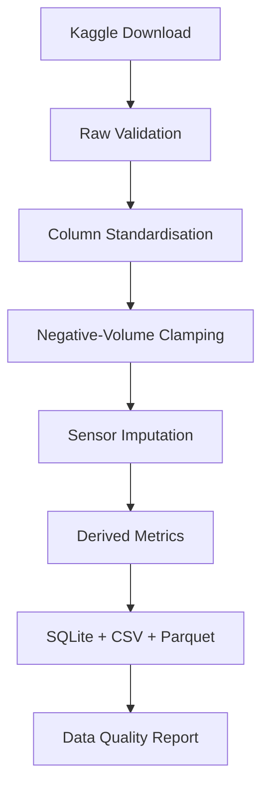

# Petroleum Data AI – Volve Field Analytics

End-to-end petroleum analytics toolkit built on the Equinor Volve field dataset.
Progressive learning path from raw data → interactive dashboard → forecasting → anomaly detection → AI agent.

### Projects completed

| # | Project | Status |
|---|---------|--------|
| 1 | Data Pipeline & Quality Layer | ✅ |
| 2 | Interactive Production Dashboard | ✅ |
| 3 | Decline Curve Forecasting (Arps) | ✅ |
| 4 | Well Performance & Anomaly Detection | ✅ |
| 5 | Well Performance Scorecard | ✅ |
| 6 | AI Engineering Agent | ✅ |

### Quick Start

```bash
git clone https://github.com/Numba1ne/petroleum-data-ai.git
cd petroleum-data-ai

python -m venv .venv
# Windows
.venv\Scripts\activate
# Linux / macOS
source .venv/bin/activate

pip install -r requirements.txt
```

**1. Configure credentials**

- **Kaggle** (for data download): see `.env.example` or `setup_kaggle.py`
- **LLM** (for AI assistant): get a free key at [openrouter.ai](https://openrouter.ai/settings/keys),
  then set `LLM_API_KEY` in `.env` or your environment (see `.env.example`).
  The default model is a free tier (`LLM_MODEL`); check
  [openrouter.ai/models?max_price=0](https://openrouter.ai/models?max_price=0) for current options.

**2. Run the data pipeline (Project 1)**

```bash
python src/pipeline/download_kaggle_data.py
python src/pipeline/clean_data.py
python verify_data.py
```

**3. Launch the dashboard (Projects 2–6)**

```bash
streamlit run dashboard/app.py
```

Open [http://localhost:8501](http://localhost:8501).

Dashboard tabs:
- 📈 Production & Injection charts
- 🧪 Water Cut & GOR diagnostics
- 🏆 Well rankings
- 🔮 Decline curve forecasts
- 🚨 Anomaly detection
- 📋 Performance scorecard
- 🤖 AI Assistant (natural-language Q&A)

---

## Project 2 – Interactive Dashboard

Run the Streamlit dashboard:

```bash
streamlit run dashboard/app.py
```

**Features:**
- Producer / Injector / All filter
- Well multi-select + date range
- KPI cards (Oil, Gas, Water, Water Injected, Water Cut, GOR)
- Production & Injection charts
- Water Cut & GOR diagnostic charts with reference lines
- Well ranking table
- 🔮 Decline-curve forecast tab (Arps models) with adjustable horizon

---

## Project 3 – Production Forecasting & Decline Curve Analysis

Fit Arps decline curves to each producer well's oil rate history, back-test on a
held-out period, and project future production.

**Models** (`forecasting/decline_curves.py`):
- Exponential — `q(t) = qi · exp(-di·t)`
- Hyperbolic — `q(t) = qi / (1 + b·di·t)^(1/b)`

Both are fit with `scipy.optimize.curve_fit`; the model with the higher R² is selected.

**Run it** (from the repo root, after the Project 1 pipeline):

```python
from forecasting.forecast import run_all_wells
from forecasting.evaluate import summarise_results
from forecasting.visualize import plot_multiple_wells

results = run_all_wells(forecast_days=365)   # fits every producer well
summary = summarise_results(results)          # R², MAPE, RMSE per well
print(summary)
plot_multiple_wells(results)                  # saves PNGs to reports/forecast_plots/
```

**Outputs:**
- Per-well forecasts → `data/processed/forecasts/<well>_forecast.csv`
- Forecast plots → `reports/forecast_plots/<well>_forecast.png`
- Metrics: train R², test MAPE, test RMSE (`forecasting/evaluate.py`)

---

## Project 1 – Pipeline Architecture



## Overview

An end-to-end ETL pipeline for the **Volve oil field** production dataset.
Raw Excel production reports are transformed into a clean, query-ready SQLite
database with automated data quality reporting.

**Key features:**

| Feature | Detail |
|---|---|
| Data source | Kaggle · `lamyalbert/volve-production-data` |
| Granularity | Daily + Monthly production per well bore |
| Outputs | SQLite, CSV, Parquet |
| Derived metrics | Water cut, GOR, on-stream efficiency |
| Well typing | Time-aware per-row PRODUCER / INJECTOR label |
| QC report | Missing % by well, completeness timeline, outlier stats |

---

## Quick Start

### 1 · Clone & install

```bash
git clone https://github.com/Numba1ne/petroleum-data-ai.git
cd petroleum-data-ai

python -m venv .venv
# Windows
.venv\Scripts\activate
# Linux / macOS
source .venv/bin/activate

pip install -r requirements.txt
```

### 2 · Configure Kaggle credentials

> ⚠️ **Never put your API key in source code or commit it to git.**

**Recommended – kaggle.json:**

1. Go to [kaggle.com/settings](https://www.kaggle.com/settings) → *Create New Token*.
2. Save the downloaded `kaggle.json` to `~/.kaggle/kaggle.json`.
3. On Linux/macOS: `chmod 600 ~/.kaggle/kaggle.json`

*Alternatively*, use a `.env` file:

```bash
cp .env.example .env
# Edit .env and fill in KAGGLE_USERNAME and KAGGLE_KEY
```

**One-time helper script** (writes `~/.kaggle/kaggle.json` for you):

```bash
python setup_kaggle.py --username <your_username> --key <your_api_key>
```

### 3 · Download the dataset

```bash
python src/pipeline/download_kaggle_data.py
# Optional: override destination
python src/pipeline/download_kaggle_data.py --dest data/raw
```

Verify the file landed at `data/raw/Volve production data.xlsx`.

### 4 · Run the pipeline

```bash
python src/pipeline/clean_data.py
# Optional: use a custom Excel path
python src/pipeline/clean_data.py --input path/to/custom.xlsx
```

### 5 · Verify outputs

```bash
python verify_data.py
```

Expected output:

```
================== Volve Pipeline Verification ==================
  [OK]  Raw Excel                  Volve production data.xlsx  (... KB)
  [OK]  Daily CSV                  daily_production_clean.csv  (... KB)
  [OK]  Daily Parquet              daily_production_clean.parquet  (... KB)
  [OK]  Monthly CSV                monthly_production_clean.csv  (... KB)
  [OK]  Monthly Parquet            monthly_production_clean.parquet  (... KB)
  [OK]  SQLite database            volve_production.db  (... KB)
  [OK]  Data quality report        data_quality_report.md  (... KB)

  Daily production rows:   15,634
  Monthly production rows: 526

  Result: 7 passed, 0 failed
=================================================================
```

### 6 · Launch the Interactive Dashboard

```bash
streamlit run dashboard/app.py
```

Navigate to [http://localhost:8501](http://localhost:8501) in your browser:
- **Field Overview KPIs**: Cumulative Oil, Gas, Water, and Water Injected, plus field Water Cut and average GOR.
- **Role & Well Filtering**: Toggle between All Wells, Producers Only, or Injectors Only with dynamic well selection.
- **Fluid Rate Visualisations**: Interactive Plotly time-series for oil, gas, water, and water injection rates.
- **Reservoir Diagnostics**: Water cut evolution (%) with 50% and 80% breakthrough thresholds, and GOR history.
- **Well Rankings**: Grouped bar charts, interactive leaderboard with formatted metrics, and CSV export.
- **Decline Curve & Forecast**: Pick a producer well and horizon (90–730 days) to fit an Arps exponential/hyperbolic model; view parameters (qi, di, b, R²), test-set MAPE/RMSE, an interactive actual-vs-fit-vs-forecast chart, and download the forecast CSV.
- **Anomaly Detection**: Statistical + decline-residual flags with severity scores, annotated timeline, event table, and CSV export.
- **Performance Scorecard**: Composite 0–100 ranking on production, water cut, anomaly burden, and decline health.
- **AI Assistant**: Natural-language Q&A over all of the above via OpenRouter tool-calling.

---

## Project Structure

```
petroleum-data-ai/
├── src/pipeline/              # Project 1 – ETL & QC
├── dashboard/                 # Projects 2–6 – Streamlit app (7 tabs)
│   ├── app.py
│   └── utils.py               # Cached data loader & ranking analytics
├── forecasting/               # Project 3 – Arps decline curves
│   ├── decline_curves.py      # Exponential / hyperbolic fits
│   ├── forecast.py            # Per-well fit + future projection
│   ├── evaluate.py            # R², MAPE, RMSE metrics
│   ├── visualize.py           # Matplotlib forecast plots
│   └── utils.py               # Producer data loader
├── anomaly_detection/         # Project 4 – Detectors & scoring
│   ├── detectors.py           # Z-score, rate change, WC jump, residuals
│   ├── scoring.py             # Weighted scores + severity labels
│   ├── pipeline.py            # End-to-end detection
│   └── utils.py               # DB loader
├── well_performance/          # Project 5 – Scorecard
│   ├── scorecard.py           # Metrics + weighted ranking
│   └── utils.py               # Producer data loader
├── ai_agent/                  # Project 6 – Tools + LLM agent
│   ├── tools.py               # Tool wrappers + TOOL_REGISTRY
│   ├── prompts.py             # System prompt
│   ├── agent.py               # OpenRouter tool-calling loop
│   └── app.py                 # CLI (python -m ai_agent.app)
├── data/
│   ├── raw/                   # Raw Excel (gitignored)
│   ├── processed/             # Cleaned data + forecasts/anomalies/scorecard (gitignored)
│   └── db/                    # SQLite database (gitignored)
├── reports/                   # QC report + forecast plots (only .md tracked)
├── notebooks/                 # Exploratory analysis
├── tests/                     # Unit tests
├── requirements.txt
├── .env.example               # Credential template (safe to commit)
└── README.md
```

---

## Querying the Database

```python
import pandas as pd
from sqlalchemy import create_engine

engine = create_engine("sqlite:///data/db/volve_production.db")

# Average water cut per producer well
df = pd.read_sql("""
    SELECT well_bore_code,
           ROUND(AVG(water_cut), 3)   AS avg_water_cut,
           ROUND(AVG(gor), 1)         AS avg_gor,
           COUNT(*)                   AS days
    FROM daily_production
    WHERE well_type = 'PRODUCER'
      AND bore_oil_vol > 0
    GROUP BY well_bore_code
    ORDER BY avg_water_cut DESC
""", engine)
print(df)
```

---

## Cleaning Logic

| Step | Daily | Monthly |
|---|---|---|
| Column normalisation | ✓ snake_case | ✓ snake_case |
| Date parsing | ✓ | ✓ |
| Negative volumes → NaN | ✓ reported in QC | ✓ |
| Sensor imputation | rolling(7) → ffill → bfill per well | – |
| Well type labelling | per-row time-aware | – |
| Water cut / GOR | safe division (NaN on zero denom) | – |
| On-stream efficiency | clipped to [0, 1] | – |

---

## Data License

The Volve dataset is published by **Equinor** under the
[Equinor Open Data License](https://www.equinor.com/en/how-and-why/digitalisation-in-our-dna/volve-field-data-village-download.html).
Please review the license terms before using this data in commercial projects.

The Kaggle mirror used here: <https://www.kaggle.com/datasets/lamyalbert/volve-production-data>

---

## Prerequisites

| Requirement | Version |
|---|---|
| Python | 3.10+ |
| RAM | ≥ 4 GB |
| Disk | ≥ 500 MB (raw Excel is ~40 MB) |

---

## Running Tests

```bash
pytest tests/
```

---

## Contributing

1. Fork the repository.
2. Create a feature branch: `git checkout -b feature/your-feature`.
3. Commit your changes: `git commit -am 'Add your feature'`.
4. Push: `git push origin feature/your-feature`.
5. Open a pull request.

See [CONTRIBUTING.md](CONTRIBUTING.md) for coding standards.

---

## Citation

```bibtex
@software{Anthony_Petroleum_Data_AI_2026,
  author  = {Anthony, Emmanuel},
  title   = {{Petroleum Data AI Toolkit}},
  url     = {https://github.com/Numba1ne/petroleum-data-ai},
  version = {1.1.0},
  year    = {2026}
}
```

---

## Contact

[Issue Tracker](https://github.com/Numba1ne/petroleum-data-ai/issues) ·
**Maintainer:** Emmanuel Anthony